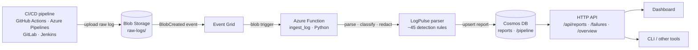

# LogPulse: Serverless QA & CI/CD Log Analyzer

LogPulse automatically extracts **test failures, build errors, crashes and security warnings** from raw CI/CD pipeline logs.

When a log file is uploaded to **Azure Blob Storage**, an event triggers a **Python Azure Function**. The function parses the text, isolates the critical error states and stores a structured report in **Azure Cosmos DB**. QA and DevOps teams get a searchable view of build failures and don't have to read thousands of log lines.



## What it detects

| Category | Tools / formats |
|---|---|
| **Test failures** | pytest, unittest, JUnit (Maven Surefire, Gradle), Jest, Go test, .NET (`dotnet test`), RSpec |
| **Build errors** | TypeScript `tsc`, javac/Maven compile, gcc/clang, Go build, Rust, mypy, npm, pip, Docker/BuildKit, Gradle, Maven goals, make |
| **Exceptions / crashes** | Python tracebacks, Java uncaught exceptions, Node.js errors with stack, Go data races |
| **Security** | npm audit, Trivy, Snyk, Bandit, pip-audit, any CVE / GHSA / PYSEC / RUSTSEC id, insecure TLS settings |
| **Secret leaks** | AWS keys, GitHub/Slack tokens, private keys, Azure storage keys, JWTs, hard-coded passwords. **Values are redacted before storage.** |
| **Infrastructure** | Out-of-memory / exit 137, segfaults, disk full, timeouts, DNS/network failures, rate limits |
| **CI runner** | `##[error]`, `::error::`, non-zero exit codes, GitLab `Job failed`, Jenkins `Finished: FAILURE` |

It also extracts **test totals** (passed/failed/skipped), detects the **CI platform**, and gives each finding a **fingerprint**. A fingerprint is a stable id for "the same problem" across builds, which lets you answer questions like *"which builds hit this timeout?"*.

## Quick start (local, no Azure needed)

```bash
python -m venv .venv
.venv\Scripts\activate          # Windows  (Linux/macOS: source .venv/bin/activate)
pip install -r requirements-dev.txt

python -m logpulse analyze samples            # analyze the bundled sample logs
python -m pytest                              # run the test suite
```

### Run the dashboard and simulate the blob trigger

```bash
python -m logpulse serve
```

Open http://127.0.0.1:7071/api/dashboard. To see the pipeline work end to end, either:

- click **Upload log** in the dashboard, or
- copy a log into the watched folder. This works like uploading to Blob Storage:
  ```bash
  mkdir .localblobs\raw-logs\web-app\101
  copy samples\gitlab-ci\web-frontend\88123\jest-and-audit.log .localblobs\raw-logs\web-app\101\
  ```
  The dev server picks it up within a second and processes it with the same `service.process_blob()` function that the Azure blob trigger calls.

Reports are saved as JSON files in `.localdb/` (the local stand-in for Cosmos DB).

### CLI

```bash
python -m logpulse analyze build.log            # summary; exit code 0 passed / 1 failed / 2 unstable
python -m logpulse analyze build.log --json     # full report document
python -m logpulse ingest samples               # parse and store, like the blob trigger
python -m logpulse query --status failed
python -m logpulse query --failures --min-severity high -q timeout
```

## Blob naming convention

Upload logs to the `raw-logs` container as:

```
raw-logs/<pipeline>/<build_id>/<file>.log      e.g. raw-logs/web-app/1234/test.log
```

`<pipeline>` becomes the Cosmos DB partition key. `.gz` files are decompressed automatically, and UTF-8 and UTF-16 logs are both supported.

## HTTP API

| Method & route | Description |
|---|---|
| `GET /api/reports` | Report summaries. Filters: `pipeline`, `status` (failed/unstable/passed), `min_severity`, `category`, `q` (free text), `fingerprint`, `since` (ISO date), `limit` |
| `GET /api/reports/{pipeline}/{id}` | Full report with every finding and its context lines |
| `GET /api/failures` | Individual findings across all builds (same filters) |
| `GET /api/overview` | Dashboard totals and the top recurring problems |
| `POST /api/analyze` | Body = raw log. Returns the report. Add `?store=true&pipeline=x&build=y` to save it (needs a function key in Azure) |
| `GET /api/dashboard` | Web dashboard |
| `GET /api/health` | Health check |

Example: every critical security finding in the `payments-api` pipeline:

```
GET /api/failures?pipeline=payments-api&category=security&min_severity=critical
```

## Report document (Cosmos DB)

```jsonc
{
  "id": "1042-pytest.log",            // from the blob path → re-uploads overwrite (idempotent)
  "pipeline": "api-service",          // partition key
  "build_id": "1042",
  "status": "failed",                 // failed | unstable | passed
  "ci_platform": "github-actions",
  "tests": { "total": 48, "passed": 45, "failed": 2, "errors": 1, "skipped": 0 },
  "severity_counts": { "critical": 2, "high": 5, "medium": 1, "low": 1 },
  "top_finding": "Possible AWS access key exposed in log",
  "findings": [
    {
      "category": "test_failure", "severity": "high", "source": "pytest",
      "title": "tests/test_orders.py::test_create_order_total failed",
      "test_name": "tests/test_orders.py::test_create_order_total",
      "message": "assert 29.969999999999995 == 29.97",
      "line": 92, "context": ["…lines around the failure…"],
      "fingerprint": "5d0c6f2a91b4e0c7", "occurrences": 1
    }
  ]
}
```

## Design decisions

- **Shared core:** everything lives in the `logpulse/` package. `function_app.py` (Azure) and `devserver.py` (local) are thin adapters, so the code that runs locally and in tests is the code that runs in Azure.
- **Idempotent processing:** blob triggers deliver *at least once*. The document id comes from the blob path, and storage uses `upsert`, so a duplicate trigger overwrites the report instead of creating a second one.
- **Partition key `/pipeline`:** the most common query ("show me this pipeline's builds") stays inside one partition, which keeps it cheap. Cross-pipeline searches use cross-partition queries.
- **Secrets never reach the database:** secret detection runs first and redacts the value before other rules or context capture can see the line.
- **Cosmos item limit:** items are capped at 2 MB. Very noisy logs are trimmed (shorter context first, then fewer of the least severe findings), and the report is flagged `findings_truncated`.
- **Parameterized SQL:** user input never goes into the Cosmos query text.
- **Stops on poison input:** an oversized log is logged and skipped instead of being retried until it lands in the poison queue.
- **Extensible:** to support a new tool, add one rule (a regex and a small builder function) in `logpulse/rules.py`.

## Project structure

```
function_app.py          Azure Functions entry point (blob trigger + HTTP routes)
host.json                Functions host config
logpulse/
  rules.py               detection rules (regex + builder per tool)
  parser.py              log cleaning, rule engine, dedup/fingerprints
  stats.py               test-count extraction from runner summaries
  models.py              Finding / LogReport data model
  service.py             use cases: process blob, list/search, overview
  store.py               Cosmos DB + local JSON backends
  api.py                 framework-agnostic HTTP handlers
  devserver.py           local server + blob-trigger simulator
  cli.py                 command-line interface
  static/dashboard.html  dashboard (no external dependencies)
infra/main.bicep         all Azure resources (Infrastructure as Code)
scripts/                 deploy.ps1 · upload-samples.ps1 · teardown.ps1 · package.py
samples/                 realistic logs from 4 CI platforms
tests/                   104 tests (pytest)
```

## Configuration

| Setting | Purpose |
|---|---|
| `LOGPULSE_STORE` | `cosmos` or `local`. Auto-detected if unset. |
| `LOGPULSE_LOCAL_DB` | Folder for the local store (default `.localdb`) |
| `COSMOS_ENDPOINT` | Cosmos DB endpoint. Uses managed identity unless `COSMOS_KEY` is set. |
| `COSMOS_KEY` / `COSMOS_CONNECTION_STRING` | Key-based auth (e.g. the Cosmos emulator) |
| `COSMOS_DATABASE` / `COSMOS_CONTAINER` | Default `logpulse` / `reports` |
| `COSMOS_CREATE_IF_MISSING` | `true` to create the database and container on startup (key auth only) |
| `LOGPULSE_MAX_LOG_BYTES` | Maximum log size to process (default 100 MB) |

## Deploying to Azure

See **[DEPLOY.md](DEPLOY.md)**. In short:

```powershell
az login
.\scripts\deploy.ps1 -Location swedencentral   # creates everything + deploys the code
.\scripts\upload-samples.ps1                   # uploads sample logs → watch the dashboard
```

The infrastructure is defined in [`infra/main.bicep`](infra/main.bicep):
- Flex Consumption Function App
- Event Grid blob events
- serverless Cosmos DB
- Application Insights

Everything authenticates with a **managed identity**, so there are no keys in the configuration.
